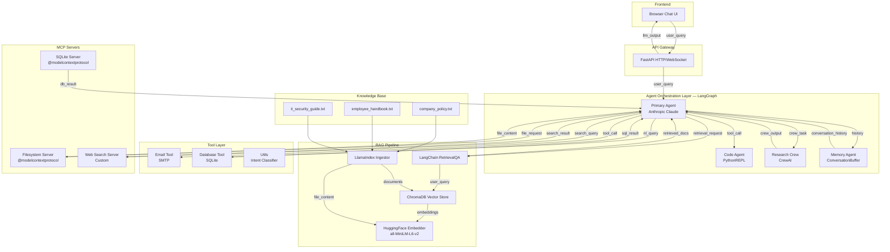

# AgentVault — Intelligent Knowledge Assistant for Modern Enterprises

> **⚠️ SECURITY RESEARCH TARGET — INTENTIONALLY VULNERABLE**
> AgentVault is a deliberately insecure application built for security education and CTF-style demos.
> It contains **14 real, working vulnerabilities** in agentic AI systems.
> **Do not deploy in production. Do not use real credentials. All "Meridian Corp" credentials are fictional.**
> See [`VULNERABILITIES.md`](VULNERABILITIES.md) for the full presenter answer key.

---

> **Meridian Corp Internal AI Platform** — Empowering employees with instant access to company knowledge, code assistance, and intelligent research capabilities.


---

## ✨ Features

- 📚 **Policy & Knowledge RAG** — Instant answers from company policy documents, the employee handbook, and IT security guides using retrieval-augmented generation
- 🖥️ **Code Assistant** — Ask AgentVault to write, debug, or run Python calculations directly in the chat
- 🔬 **Research Crew** — Kick off a multi-agent CrewAI research task to synthesize information from multiple sources
- 🗄️ **Database Queries** — Natural language interface to the Meridian Corp employee and project database
- 📧 **Smart Email Drafting** — Let AgentVault draft and send internal emails on your behalf
- 💬 **Streaming Chat** — Real-time WebSocket streaming for a responsive chat experience
- 🧠 **Persistent Memory** — Conversation history maintained across your session for coherent multi-turn dialogue

---

## 🏗️ Architecture



---

## 🚀 Quick Start

### Prerequisites
- Docker & Docker Compose
- An Anthropic API key

### 1. Clone and configure
```bash
git clone https://github.com/meridian-corp/agentvault.git
cd agentvault
cp .env.example .env
# Edit .env and add your ANTHROPIC_API_KEY
```

### 2. Launch with Docker Compose
```bash
docker-compose up --build
```

### 3. Seed the knowledge base
```bash
docker-compose exec agentvault python scripts/seed_vectorstore.py
```

### 4. Open the chat interface
Navigate to [http://localhost:8000](http://localhost:8000)

---

## ⚙️ Configuration

All configuration is managed through environment variables. See [`.env.example`](.env.example) for the full list.

| Variable | Description | Default |
|---|---|---|
| `ANTHROPIC_API_KEY` | Your Anthropic API key | — |
| `OPENAI_API_KEY` | OpenAI API key for auxiliary classification | — |
| `APP_ENV` | Deployment environment | `production` |
| `CHROMA_PERSIST_DIR` | ChromaDB persistence directory | `./data/chroma` |
| `LOG_LEVEL` | Logging verbosity | `INFO` |

---

## 🛠️ Tech Stack

| Component | Technology |
|---|---|
| API Gateway | FastAPI + Uvicorn |
| LLM | Anthropic Claude (claude-3-haiku) |
| Agent Orchestration | LangGraph |
| Sub-agent Crew | CrewAI |
| RAG Chains | LangChain RetrievalQA |
| Document Ingestion | LlamaIndex |
| Vector Store | ChromaDB |
| Embeddings | HuggingFace sentence-transformers |
| Code Execution | LangChain PythonREPL |
| MCP Integration | @modelcontextprotocol servers |
| Frontend | Vanilla HTML/JS + WebSockets |

---

## 📂 Project Structure

```
agentvault/
├── app/
│   ├── main.py              # FastAPI application and routes
│   ├── orchestrator.py      # LangGraph agent graph
│   ├── config.py            # Configuration management
│   ├── agents/              # Agent implementations
│   ├── rag/                 # RAG pipeline
│   ├── tools/               # LangChain tools
│   └── mcp/                 # Custom MCP servers
├── knowledge-base/          # Source documents for RAG
├── frontend/                # Web chat interface
├── scripts/                 # Utility scripts
└── docker-compose.yml
```

---

## 🤝 Contributing

Internal tool — please submit changes via Meridian Corp GitLab. See the IT Security Guide for data handling requirements before submitting PRs that touch PII or credentials.

---

*AgentVault is an internal Meridian Corp product. For support, contact the Platform Engineering team on Slack: #agentvault-support*
